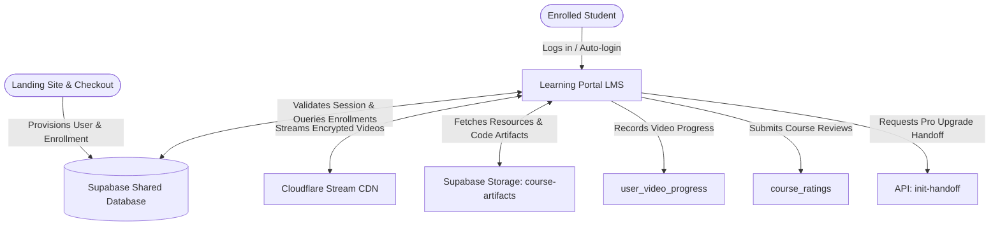
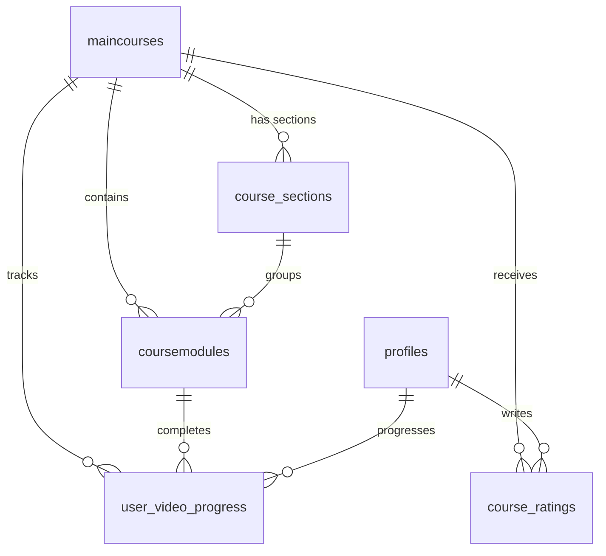
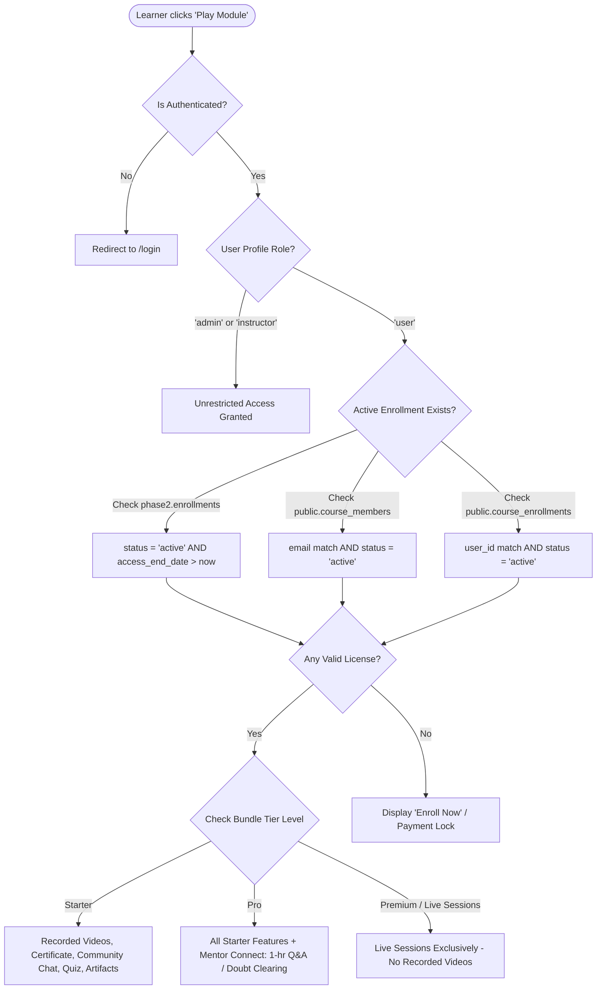
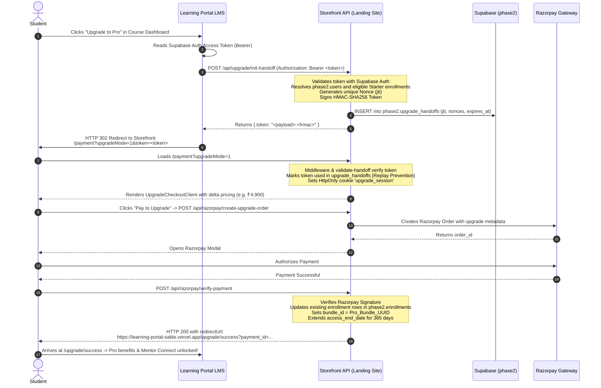

# STANDARD OPERATING PROCEDURE (SOP)
## The Auto-Mate — Learning Management System (LMS Portal)

**Document ID:** SOP-AUTOMATE-LMS-002  
**Target System:** `The Auto-Mate Learning Portal` (LMS Web Application)  
**Associated Systems:** `web` (Landing Site & Storefront) & `automate-studio` (Sanity Studio CMS)  
**Classification:** Enterprise System Architecture, Data Contract & Operational Playbook  
**Last Updated:** Current Production State  

---

## 1. Executive Summary & Purpose

The **Auto-Mate Learning Portal** is the dedicated, authenticated Learning Management System (LMS) where enrolled students access course materials, stream video lectures, take quizzes, download coding artifacts, track module progress, and participate in course reviews.

While the **Landing Site (`web`)** serves as the public commercial storefront and payment gateway, the **Learning Portal** is the operational core where educational content is delivered and learner progress is tracked. Both systems operate in tandem over a unified **Supabase PostgreSQL & Auth** backend, Cloudflare Stream video infrastructure, and an HMAC-SHA256 authenticated cross-portal upgrade protocol.



---

## 2. System Architecture & Environment Ecosystem

### 2.1 Core Technology Stack

| Layer | Technology | Operational Function |
| :--- | :--- | :--- |
| **Frontend Framework** | **Next.js (App Router / SSR) / React** | Secure student dashboard, interactive video player, curriculum drawer, quiz modules |
| **Authentication & IAM** | **Supabase Auth (JWT) & `public.profiles`** | Identity, token issuance, session preservation, role verification (`user`, `instructor`, `admin`) |
| **Database Engine** | **Supabase PostgreSQL (Multi-schema)** | Relational models across `public` (LMS curriculum/progress) and `phase2` (enrollments/licenses) |
| **Video Streaming Delivery** | **Cloudflare Stream (`videodelivery.net`)** | Adaptive bitrate HLS/DASH video delivery with watermarking and direct embed iframes |
| **Asset Storage** | **Supabase Storage (`course-artifacts`)** | Code templates, automation scripts, assignment starter repos, PDFs |
| **Cross-Portal Interop** | **HMAC-SHA256 Nonce Tokens** | Secure handoff for Starter-to-Pro student plan upgrades without session fragmentation |

### 2.2 Operational URLs & Endpoints

| Environment | Service | URL / Base Address |
| :--- | :--- | :--- |
| **Development** | Storefront & Checkout | `http://localhost:3000` |
| **Development** | Learning Portal | `http://localhost:3001` (`LEARNING_PORTAL_URL`) |
| **Production** | Storefront & Checkout | `https://landing-site-xi.vercel.app` |
| **Production** | Learning Portal | `https://learning-portal-sable.vercel.app/login` |
| **Video CDN** | Cloudflare Stream Embed | `https://iframe.videodelivery.net/{video_cf_id}` |
| **Thumbnail CDN** | Cloudflare Video Poster | `https://videodelivery.net/{video_cf_id}/thumbnails/thumbnail.jpg` |

---

## 3. Database Architecture & Data Contracts

The Learning Portal directly relies on both the `public` schema and the `phase2` schema in Supabase.

### 3.1 Course Curriculum & Content Schema (`public`)



#### A. `public.maincourses`
The authoritative registry of courses delivered within the portal:
* `id` (`UUID`, PK): Unique course identifier.
* `title` (`TEXT`): Official course name (e.g., "Selenium Automation Masterclass", "Cypress & Playwright Bootcamp").
* `product_id` (`UUID` / `TEXT`): Corresponds to `public.products.id` for cross-system mapping.
* `description` (`TEXT`): In-portal course overview and syllabus brief.
* `thumbnail_url` (`TEXT`): Visual banner for course cards.
* `is_active` (`BOOLEAN`): Active delivery flag.

#### B. `public.course_sections`
Logical structural units within a course (e.g., "Section 1: Setup & Architecture", "Section 2: Writing Robust Assertions"):
* `id` (`UUID`, PK): Unique section identifier.
* `maincourse_id` (`UUID`, FK): Reference to `public.maincourses.id`.
* `title` (`TEXT`): Section title.
* `order_index` (`INT`): Display sequence order.

#### C. `public.coursemodules`
Individual lectures, exercises, quizzes, or artifacts within a section:
* `id` (`UUID`, PK): Unique module identifier.
* `maincourse_id` (`UUID`, FK): Reference to parent course.
* `section_id` (`UUID`, FK, Nullable): Reference to `course_sections.id`.
* `title` (`TEXT`): Lecture / module title.
* `duration` (`TEXT`): Human-readable duration (e.g., `"14:20"` or `"45m"`).
* `order_index` (`INT`): Sequence order within the section or course.
* `description` (`TEXT`): Lecture notes, markdown summaries, or prerequisites.
* `thumbnail_url` (`TEXT`): Preview thumbnail for video.
* `video_cf_id` (`TEXT`): **Cloudflare Stream Video ID** used to construct video streaming iframes.
* `module_type` (`TEXT`): Type of learning activity:
  - `video`: Standard streaming video lecture.
  - `preview`: Publicly previewable video accessible before purchase.
  - `quiz`: Interactive multiple-choice or coding assessment.
  - `artifact`: Downloadable asset (e.g., `.zip` source code, test data files, cheat sheets).

#### D. `public.user_video_progress`
Maintains granular module progress, watch state, and resume bookmarks:
* `id` (`UUID`, PK): Unique progress entry ID.
* `user_id` (`UUID`, FK): Learner's Supabase Auth UID (`auth.users.id`).
* `course_id` (`UUID` / `TEXT`): Course identifier.
* `video_id` (`UUID` / `TEXT`): Corresponds to `coursemodules.id`.
* `completed` (`BOOLEAN`): `true` when learner has finished the module.
* `progress_seconds` (`NUMERIC`): Last recorded playback position for resume.
* `updated_at` (`TIMESTAMPTZ`): Timestamp of last interaction (used to auto-resume).

#### E. `public.course_ratings`
Learner feedback, star ratings, and detailed text testimonials:
* `id` (`UUID`, PK): Review ID.
* `course_id` (`UUID` / `TEXT`): Course identifier.
* `product_id` (`UUID` / `TEXT`): Product identifier.
* `user_id` (`UUID`, FK): Author's `auth.users.id` or `phase2.users.id`.
* `rating` (`NUMERIC`): Star score (1.0 to 5.0).
* `review` (`TEXT`): Qualitative student feedback.
* `created_at` (`TIMESTAMPTZ`): Submission timestamp.

---

### 3.2 Access Entitlement & License Schema (`phase2` & `public`)

To determine if a student has the right to view a module or stream video content, the Learning Portal evaluates:



* **License Expiration Policy**: Standard enrollments grant 365 days of active access (`access_start_date` to `access_end_date`).
* **Tier Entitlements & Plan Matrix**:
  - **`Starter` (Tier 1)**:
    1. **Recorded Video Sessions**: Full access to on-demand video lectures delivered via Cloudflare Stream.
    2. **Completion Certificate**: Official verifiable certificate upon finishing course modules.
    3. **Community Chat**: Access to student peer groups and cohort community channels.
    4. **Quizzes**: Interactive self-assessment quizzes and module knowledge checks.
    5. **Artifacts**: Downloadable project templates, source code repositories, and automation cheat sheets.
  - **`Pro` (Tier 2)**:
    - **All Starter Features Included**: Complete access to all 5 Starter benefits (Recorded Videos, Certificate, Community Chat, Quizzes, Artifacts).
    - **Mentor Connect**: Dedicated 1-hour live Q&A and doubt-clearing session with senior automation/SDET mentors.
  - **`Premium / Live Sessions` (Tier 3)**:
    - **Live Sessions Exclusively**: No access to recorded video sessions; learning is conducted entirely through live interactive cohort sessions with real-time instructor feedback.

---

## 4. Learner Journey & Key Subsystems

### 4.1 Authentication, Auto-Login & Deep-Link Resumption

The Learning Portal receives authentication traffic from three sources:

1. **Direct Login**: Learner visits `/login` and enters email + password.
2. **Post-Purchase Auto-Provisioning (`/login?email=...&newUser=true`)**:
   - Storefront checkout creates the user's Supabase Auth credentials and redirects them to the portal.
   - Portal detects `newUser=true`, informs the user of their new account setup, auto-populates their email, and guides them into the dashboard.
3. **Smart Resume Deep-Linking**:
   - When a learner clicks "Resume Course" in the Storefront navbar, the client executes a query against `public.user_video_progress`:
     ```sql
     SELECT video_id, completed, updated_at 
     FROM public.user_video_progress 
     WHERE course_id = :courseId 
     ORDER BY updated_at DESC 
     LIMIT 20;
     ```
   - It identifies the most-recently updated incomplete module (`!completed`) and generates a direct deep-link:
     ```
     https://learning-portal-sable.vercel.app/login?next=/courses/{courseId}?module={moduleId}&email={userEmail}
     ```
   - Upon login, the portal automatically routes the student directly to that specific lecture and playback position.

### 4.2 Interactive Course Player & Video Streaming

1. **Streaming Delivery**:
   - Videos are hosted via **Cloudflare Stream** and referenced by `coursemodules.video_cf_id`.
   - The portal embeds Cloudflare's optimized player:
     ```html
     <iframe
       src="https://iframe.videodelivery.net/{video_cf_id}?autoplay=true&poster=https://videodelivery.net/{video_cf_id}/thumbnails/thumbnail.jpg"
       allow="accelerometer; autoplay; encrypted-media; gyroscope; picture-in-picture"
       allowfullscreen
     ></iframe>
     ```
2. **Curriculum Drawer**:
   - Displays all `course_sections` and nested `coursemodules`.
   - Distinct icons represent module categories:
     - 🖥️ **Video Lecture**: Standard video lesson with duration indicator.
     - ❓ **Quiz**: Interactive evaluation component.
     - 📄 **Artifact**: Direct download button querying `course-artifacts` Supabase Storage bucket.
     - 🎬 **Preview**: Open access sample video.
3. **Progress Telemetry**:
   - The player emits periodic playback heartbeats.
   - On video completion (or >90% watch time), the portal updates `user_video_progress.completed = true`, automatically triggering visual checkmarks in the curriculum list and updating overall course completion percentage.

### 4.3 Student Ratings & Feedback Submission

1. Once a student completes a substantial milestone (e.g., 25% or 50% of the course), the portal provides a rating interface.
2. The student submits a 1-to-5 star rating and optional text review.
3. Submissions write to `public.course_ratings`.
4. The Storefront asynchronously aggregates this data via `getCourseRating(courseId)` and displays live average scores and testimonials on marketing pages.

---

## 5. Cross-Platform Pro Upgrade Handoff Protocol

When a student who currently holds a **Starter** license wishes to upgrade to **Pro** (adding **Mentor Connect: 1-hour live Q&A / doubt clearing session** to their existing recorded lectures, certificates, quizzes, community chat, and artifacts), the Learning Portal coordinates an authenticated handoff with the Landing Site to avoid double-charging or password re-entry.



---

## 6. Role-Based Access Control (RBAC) Specification

| Role | Profile Key (`role`) | Permissions & Privileges in Learning Portal |
| :--- | :--- | :--- |
| **Student / Learner** | `user` | • Stream video lectures for explicitly enrolled courses.<br/>• Download artifacts from enrolled courses.<br/>• Track personal video watch progress in `user_video_progress`.<br/>• Submit reviews in `course_ratings`.<br/>• Blocked from administrative tools and instructor dashboards. |
| **Mentor / Instructor** | `instructor` | • Automatic full access to all `maincourses` and curriculum modules.<br/>• Review student assignments and code submissions.<br/>• Participate in discussion boards.<br/>• **Blocked by storefront role-gate** from purchasing courses. |
| **System Admin** | `admin` | • Unrestricted read/write access to all portal modules.<br/>• Manage curriculum modules, upload Cloudflare Stream video IDs.<br/>• Upload code artifacts to Supabase Storage.<br/>• Moderate student reviews and manage user permissions.<br/>• **Blocked by storefront role-gate** from purchasing courses. |

---

## 7. Storage & Cloud Infrastructure Playbook

### 7.1 Cloudflare Stream Management
1. **Video Ingestion**:
   - Instructors export master 1080p / 60fps MP4 or MOV files.
   - Upload video file to Cloudflare Stream Dashboard or via Direct Creator Upload API.
   - Retrieve the resulting `video_cf_id` (e.g., `6407cfa00057420ed411afce4da44c62`).
2. **Module Association**:
   - In Supabase `public.coursemodules`, populate the `video_cf_id` field.
   - The LMS portal and storefront sample video previews instantly pick up this ID.

### 7.2 Code Artifacts Storage (`course-artifacts`)
1. **Bucket Configuration**:
   - Name: `course-artifacts` (configured via `NEXT_PUBLIC_SUPABASE_ARTIFACTS_BUCKET`).
   - Access Policy: Authenticated download only. Students must hold an active enrollment in the parent course.
2. **Uploading Artifacts**:
   - Standard structure: `/{course_id}/modules/{module_id}/{filename}.zip`
   - Files are served via signed URLs generated by the portal's backend.

---

## 8. Operational Playbook & Support Procedures

### SOP-LMS-01: Verifying Course Access for a Complaining Student
1. **Step 1: Check Auth Identity**
   - Query `public.profiles` by student email to verify their `id` (Supabase Auth UID).
2. **Step 2: Check License Status**
   - Query `phase2.enrollments`:
     ```sql
     SELECT e.id, e.status, e.access_start_date, e.access_end_date, b.bundle_name
     FROM phase2.enrollments e
     JOIN phase2.bundles b ON e.bundle_id = b.id
     JOIN phase2.users u ON e.user_id = u.id
     WHERE u.email = 'student@example.com';
     ```
   - Verify `status = 'active'` and `access_end_date > NOW()`.
3. **Step 3: Check LMS Sync Tables**
   - Verify that student's email exists in `public.course_members`.
   - Verify that student's `auth_user_id` exists in `public.course_enrollments`.
   - If missing due to an interrupted webhook, execute a manual synchronization using the student's Auth UID and Course ID.

### SOP-LMS-02: Troubleshooting Video Playback Failures
1. **Symptom: Black screen or "Video not found" in player**
   - Check `coursemodules.video_cf_id` for that specific lecture.
   - Verify that the video has finished encoding in the Cloudflare Stream dashboard (status must be `ready`).
   - Confirm Cloudflare API tokens (`CLOUDFLARE_API_TOKEN`) and account ID (`CLOUDFLARE_ACCOUNT_ID`) are active.

### SOP-LMS-03: Resetting Stalled Module Progress
1. If a student reports that a quiz or video completion checkmark will not register:
   ```sql
   UPDATE public.user_video_progress
   SET completed = true, updated_at = NOW()
   WHERE user_id = :authUserId AND video_id = :moduleId;
   ```

---

## 9. Environment Configuration Template

To operate the Learning Portal locally or deploy to staging, ensure the following environment keys are populated:

```ini
# Supabase Connectivity
NEXT_PUBLIC_SUPABASE_URL="https://rqeqcwlchxfboqtghkko.supabase.co"
NEXT_PUBLIC_SUPABASE_ANON_KEY="<public_anon_key>"
SUPABASE_SERVICE_ROLE_KEY="<service_role_key>"
NEXT_PUBLIC_SUPABASE_ARTIFACTS_BUCKET="course-artifacts"

# Video Delivery Infrastructure
CLOUDFLARE_ACCOUNT_ID="6407cfa00057420ed411afce4da44c62"
CLOUDFLARE_API_TOKEN="<cloudflare_api_token>"

# Cross-Portal Integration
PORTAL_URL="http://localhost:3001"
NEXT_PUBLIC_PORTAL_URL="http://localhost:3001"
LANDING_SITE_URL="http://localhost:3000"
NEXT_PUBLIC_LANDING_SITE_URL="http://localhost:3000"
UPGRADE_HANDOFF_SECRET="48bfeeaca0350e8de2c5013046276fd932629c973901c5921369fdbf107ae11c"
```
